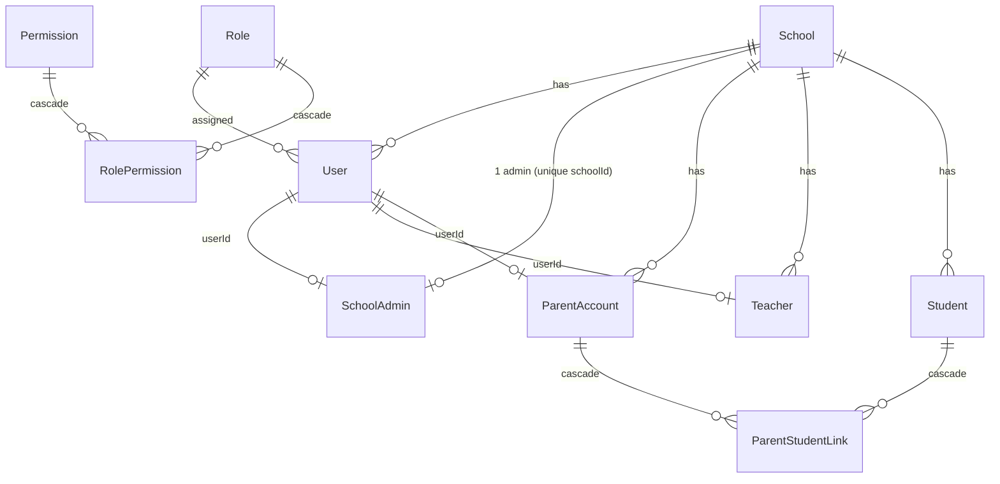
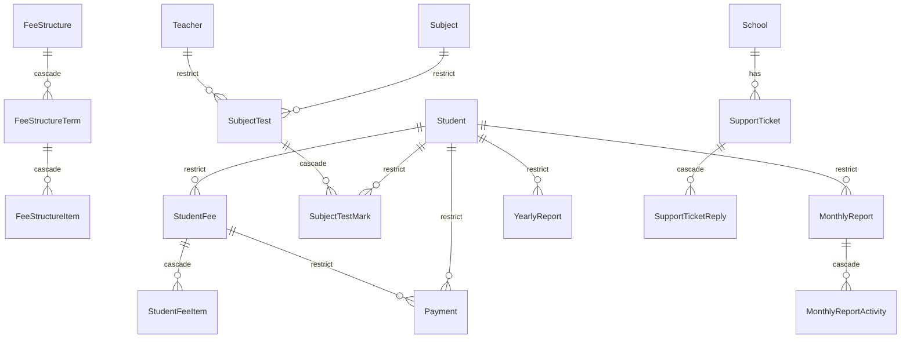

# 13 - Data Relationships and Module Dependencies (A5)

## Scope
Relationship map of `prisma/schema.prisma` (52 models, 1,775 lines), delete/cascade behaviour, plain-string references that stand in for foreign keys, orphan risks, the module dependency graph of `lib/` and feature folders, circular imports and duplicated business logic.

## Method
- Read every `@relation` and `onDelete` in the schema (grep of 160+ lines, then reading the model blocks for Student, Class/Section, Attendance, Homework, ExamSchedule, Payment/StudentFee, Teacher).
- Built an import graph for all 703 `.js/.jsx/.mjs` files outside `node_modules`/`.next`/`audit-reports` with a throwaway Node script placed in the scratch directory (reads source only; handles `@/` alias, relative paths, static and dynamic imports; comment-only lines excluded). Output: cycle detection (Tarjan SCC), `lib -> components/app` edges, fan-in.
- Read-only orphan SELECTs against the LOCAL database only (script confirmed host `localhost:5432` before connecting; no production access). Data is the local demo seed, so counts show the kind of drift possible, not production state.
- Reconciled with 05 (DB-xxx) and 03 (API/BIZ) findings; forward references in 05 to REL-001/002/003 are defined here.

## Summary table
| ID | Sev | Conf | Title | Component |
|---|---|---|---|---|
| REL-001 | P2 | High | Fee and payment relationship: denormalised `paidAmount` with unconstrained Payment links | StudentFee, Payment |
| REL-002 | P2 | High | Student delete cascade policy is inconsistent across child tables | Student |
| REL-003 | P2 | High | Login identities are not unique across tenants (Teacher has no unique email) | Teacher, ParentAccount, User, SchoolAdmin |
| REL-004 | P2 | High | Class, section and subject are plain strings in most tables; names drift from master data | Student, Attendance, Homework, ExamSchedule, TimeTable, Teacher.assignments |
| REL-005 | P3 | Medium | Student placement has two sources of truth (strings on `Student` and `StudentEnrollment` FKs) | Student, StudentEnrollment |
| REL-006 | P3 | Medium | No tenant off-boarding path: every `School` FK is Restrict, children mixed | School |
| REL-007 | P3 | High | Duplicated helpers and business rules across lib and components | lib, components |
| REL-008 | P3 | Medium | Module structure: god modules and a cycle avoided only by file-splitting and comments | lib/api.js, lib/students.js, lib/fees.js |

## Relationship map

### Core tenant and identity


### Academic structure and student data
```mermaid
erDiagram
  School ||--o{ AcademicSession : has
  School ||--o{ Class : has
  Class ||--o{ Section : "cascade"
  Teacher ||--o{ Section : "classTeacher SetNull"
  Student ||--o{ StudentEnrollment : cascade
  AcademicSession ||--o{ StudentEnrollment : restrict
  Class ||--o{ StudentEnrollment : restrict
  Section ||--o{ StudentEnrollment : restrict
  Student ||--o{ StudentPromotionLog : cascade
  Student ||--o{ ExamMark : cascade
  Student ||--o{ ExamResult : cascade
  Student ||--o{ ExamOptionalEnrollment : cascade
  Student ||--o{ ParentNotification : cascade
  Exam ||--o{ ExamSchedule : cascade
  ExamSchedule ||--o{ ExamMark : cascade
  Exam ||--o{ ExamResult : cascade
  Exam ||--o{ ExamAuditLog : cascade
  Exam ||--o| Exam : "retake parentExamId"
```

### Money, performance, support


Without any relation (pure strings or JSON): `Attendance` (class/section/date, JSON `records` with student ids), `TeacherAttendance.records`, `Teacher.assignments` JSON, `TimeTable.schedule` JSON, `Homework`, `Notice` (class/section/recipient strings), `CalendarEvent.appliesToClasses/Sections`, `PushToken.ownerId`, `AdminNotification`, `ReportLock`.

## Cascade and onDelete behaviours
- Cascade (child follows parent): role to permissions, fee structure tree, student fee to items, class to sections, exam to schedules/marks/results/audit, student to enrollments, promotion log, exam marks, exam results, optional enrollments, parent links, parent notifications, support ticket to replies, monthly report children, subject test marks (by test).
- SetNull: `Section.classTeacherId` only (`schema.prisma:839`).
- Restrict (implicit default, no `onDelete`): every `School` relation, `StudentFee`/`Payment` to `Student`, `Payment` to `StudentFee`, enrollment to session/class/section, `SubjectTest` to teacher and subject, reports to student. `TeacherLeave.teacher`, `Teacher` deletion: not examined in depth.
- Consequence for hard delete of a student (`lib/students.js:695-720`): fails only when fee/payment/report/test-mark rows exist; otherwise silently cascades marks, results, enrollments and the promotion log (REL-002, DB-005).
- Deleting a class cascades its sections but `Student.class/section` strings, `Attendance`, `Homework`, `ExamSchedule` keep the name (REL-004).

## Findings

### REL-001 - Fee/payment relationship: denormalised total, loose invariants
- **Category:** Database
- **Severity:** P2   **Confidence:** High   **Status:** Confirmed (schema and code-based)
- **Affected component:** `StudentFee.paidAmount`, `Payment`, Razorpay verify, manual collect
- **Evidence:** `schema.prisma:537-568` (`StudentFee` holds `paidAmount`) and `:1427-1450` (`Payment` with `studentFeeId`, `studentId`, both FK Restrict, no composite integrity that `Payment.studentId` equals `StudentFee.studentId`, no CHECK). `lib/fees.js:1025-1058` updates `paidAmount` by absolute value derived outside the transaction (DB-002). `Payment` has no index on the two FKs (DB-004).
- **Impact:** The ledger total and the payment rows can diverge after races, and nothing in the database detects it; a Payment can be attached to a fee of a different student if a caller passes mismatched ids (no such caller observed; not enforced).
- **Reproduction / verification:** code-based; reconciliation query `SELECT sf.id FROM "StudentFee" sf LEFT JOIN "Payment" p ON p."studentFeeId"=sf.id AND p.status='SUCCESS' GROUP BY sf.id HAVING sf."paidAmount" <> COALESCE(SUM(p.amount),0)` run in a scratch DB.
- **Root cause:** Running total stored instead of derived, no DB-level invariants.
- **Recommended fix:** Atomic `increment` update with a guarded `where` (DB-002), CHECK constraints on amounts, drop `Payment.studentId` redundancy or add a composite FK, schedule a reconciliation job; add the two FK indexes.
- **Validation:** Reconciliation query returns zero rows after concurrency tests.
- **Effort:** M   **Dependencies:** DB-002, DB-004, DB-010, BIZ-003

### REL-002 - Student delete cascade policy is inconsistent
- **Category:** Database
- **Severity:** P2   **Confidence:** High   **Status:** Confirmed
- **Affected component:** `Student` hard delete; children `ExamMark`, `ExamResult`, `StudentEnrollment`, `StudentPromotionLog`, `ParentNotification` (Cascade) versus `StudentFee`, `Payment`, reports (Restrict)
- **Evidence:** `schema.prisma:1020,1046,1179,1216,1260,1362` (Cascade) against `:542,1432,1484,1538,1613` (Restrict); `lib/students.js:695-720` handles only the P2003 path with an explanatory message. Full analysis: DB-005. Attendance JSON ids are not touched at all (DB-007).
- **Impact:** Result and enrollment history is deleted when a student has no fee rows; dangling ids remain in attendance JSON for every student ever deleted.
- **Recommended fix:** Per DB-005: make delete a status change/archive; Restrict on results and promotion log; purge or ignore ids in attendance JSON.
- **Validation:** Attempt to delete a student with marks only: refused.
- **Effort:** M   **Dependencies:** DB-005, DB-007

### REL-003 - Login identities not unique across tenants
- **Category:** Database / Security
- **Severity:** P2   **Confidence:** High   **Status:** Confirmed
- **Evidence:** Unique per-school only on `ParentAccount` and `User`; `Teacher` has no unique on `loginEmail`/`email` (`schema.prisma:678`); lookups by email alone. Full analysis and verification: DB-003 (the relationship angle is that one human can map to several identity rows with no cross-link, `userId` is optional on `Teacher`, `ParentAccount`, `SchoolAdmin`).
- **Impact:** Wrong-tenant login or lockout when two schools reuse an address.
- **Recommended fix:** As DB-003.
- **Validation:** As DB-003.
- **Effort:** M   **Dependencies:** DB-003

### REL-004 - Class, section and subject as plain strings
- **Category:** Database
- **Severity:** P2   **Confidence:** High   **Status:** Confirmed (schema); drift evidence from the local DB only
- **Affected component:** Student, Attendance, Homework, ExamSchedule, ExamResult, TimeTable, Notice, SubjectTest, MonthlyReport, Teacher.assignments, `Class.subjects String[]`
- **Evidence:** Strings: `Student.class/section/academicSession` (`schema.prisma:366-368`), `Attendance.className/sectionName` (`:869-870`), `Homework.className/sectionName/subject` (`:959-961`), `ExamSchedule.subject/className/sectionName` (`:1121-1123`), `ExamResult` (`:1275-1276`), `TimeTable` (`:809-811`), `SubjectTest` className/sectionName (`:1466-1467`), `Class.subjects String[]` (`:753`), `Teacher.assignments Json?` (`:661`). Schema comments themselves acknowledge it (`:770`: renaming a subject has to be handled in code, `:603`, `:802`). Proper FKs exist only for `Section.classId`, `StudentEnrollment` and `SubjectTest.subjectId`. Local read-only checks (demo seed data, `localhost`): 190 students, 0 without a matching Class row, 0 without a matching Section, 0 without enrollment; 18 `Homeworks` rows whose `subject` matches no `Subjects` row; 3 `Attendance` rows with no matching Class+Section pair; 0 exam schedules without a class.
- **Impact:** Renaming or deleting a class/section/subject cannot cascade: history keeps the old text (partly intended for snapshots, as in `MonthlyReport`, but not for live relationships such as Homework or Teacher assignments). Orphans surface as blank or "Unassigned" values in UI and as silently excluded rows in `where` equality filters. Joins cannot be indexed on ids, and every analysis does text matching.
- **Reproduction / verification:** Local SELECTs as stated above (read-only); production not checked.
- **Root cause:** Names used as keys; master tables added later (`Class`, `Section`, `Subject`, `StudentEnrollment`) without migrating consumers.
- **Recommended fix:** Smallest path: keep strings but (a) forbid rename/delete of a class, section or subject that has dependants (count by text match in code) and (b) validate on write against master data. Longer path: add nullable `classId/sectionId/subjectId` to Homework, ExamSchedule, Attendance, TimeTable, backfill, then dual-read.
- **Validation:** Orphan SELECT list stays empty after rename/delete attempts; backfill row counts match.
- **Effort:** L   **Dependencies:** BIZ-007, DB-007, DB-011

### REL-005 - Two sources of truth for student placement
- **Category:** Database
- **Severity:** P3   **Confidence:** Medium   **Status:** Confirmed (structure); inconsistency not observed locally
- **Evidence:** `Student.class/section/academicSession` are updated by `promoteStudents` with a separate `StudentEnrollment` row written in the same transaction (`lib/students.js:774-805`); lists and fees query the `Student` strings (`lib/fees.js:436-439`, `lib/classes.js:232-236`); history reads use enrollments (`lib/students.js:906-928`). Local check: all 190 students have an enrollment.
- **Impact:** Any write path that updates one and not the other (admin edit of class on the student form, import) creates silent divergence; reports by session can disagree.
- **Recommended fix:** Choose the enrollment as the source of truth for session placement and treat `Student.class/section` as a cached current-session value written only through one function; add a consistency SELECT to a weekly check.
- **Validation:** Consistency query returns zero rows.
- **Effort:** M   **Dependencies:** REL-004, BIZ-008

### REL-006 - No tenant off-boarding or retention design
- **Category:** Database
- **Severity:** P3   **Confidence:** Medium   **Status:** Confirmed (schema); no delete path was found in code (not exhaustively searched)
- **Evidence:** All `School` relations are default Restrict (about 40 models), while descendants mix Cascade (`Class -> Section`) and Restrict (`Payment`). No `School` delete route was identified in `app/api/schools`.
- **Impact:** A school cannot be removed or exported in a defined, ordered way (right-to-erasure, contract end); manual SQL deletion would need a hand-written ordering.
- **Recommended fix:** Define a documented offboarding job (export, then soft-deactivate, then ordered purge) rather than changing FK actions; keep Restrict.
- **Validation:** Dry-run on a scratch DB deletes one tenant completely with no orphans.
- **Effort:** L   **Dependencies:** privacy items in report 11

### REL-007 - Duplicated helpers and rules
- **Category:** Other / Maintainability
- **Severity:** P3   **Confidence:** High   **Status:** Confirmed
- **Evidence:** `formatCurrency` redefined as a local function in 19 files, for example `components/dashboard/PendingFeesCard.jsx:5`, `components/fees/CollectFeeModal.jsx:19`, `components/dashboard/FeeCollectionChart.jsx:9`; `toLocalDateStr` defined four times (`lib/dateUtils.js:8` canonical, `lib/homework.js:10`, `components/students/StudentAttendanceTab.jsx:16`, `app/api/attendance/report/route.js:8`); teacher-scope rule "assignment is Active and matches class/section" implemented in `lib/roleGuard.js:47-77` and re-derived in components via `.filter((a) => a.class === selectedClass)` (`components/homework/HomeworkFormModal.jsx:57`, `components/notices/NoticeFormModal.jsx:125`, `components/attendance/DailyAttendanceBoard.jsx:61`) and in SQL (`lib/teachers.js:204`, JSON `@>`) and JS (`lib/notices.js:426-447`). Fee late-fee and discount maths is in `lib/fees.js:100-123` only; components consume server-computed values (not exhaustively verified).
- **Impact:** A change in date or scope rules must be repeated in several places; the local copies in `lib/homework.js` and the report route also use local-time formatting, which relates to DB-006.
- **Recommended fix:** Import `lib/dateUtils.js` everywhere; add `lib/formatters.js` (`formatCurrency`) imported by the 19 files; keep one scope function and make the client filters call it.
- **Validation:** `grep -rn "function formatCurrency\|function toLocalDateStr"` returns one definition each.
- **Effort:** S   **Dependencies:** DB-006

### REL-008 - Module structure: god modules and cycle-avoidance by convention
- **Category:** Other / Maintainability
- **Severity:** P3   **Confidence:** Medium   **Status:** Confirmed
- **Evidence:** Import graph (703 files): **no static circular import** (SCC count 0 once comment lines are excluded). The absence is deliberate: comments in `lib/students.js:436-445` (a dynamic `import('./fees')` would be traced into the client bundle and break the build), `lib/feeConstants.js:7`, `lib/teachers.js:70`, `lib/classes`/`lib/auth/schoolContext.js:13-19` record that constants were split out and `addStudent` callers call fee generation themselves to avoid cycles. Without those splits `students -> fees -> students`, `classes -> students -> fees -> classes`, `iam -> currentUser -> teachers -> students` would loop. Largest fan-in: `lib/iam.js` (129 importers), `lib/rbac.js` (121), `lib/api.js` (121 imports across components; 2,181 lines, 190 exports, a single client fetch layer), `lib/auth/schoolContext.js` (73), `lib/students.js` (47), `lib/db.js` (47). `lib/` files never import `components` or `app` (grep confirmed none). Client components import `lib/api.js` (119 files) and constants modules; server-only modules guarded by comments rather than `server-only`.
- **Impact:** Risk is accidental client-bundle inclusion of server modules (next/headers, Prisma) and refactor friction, not a runtime circularity. `lib/api.js` as a single 2,181-line module couples every client feature (tree-shaking of named exports mitigates bundle weight; not measured).
- **Recommended fix:** Add `import 'server-only'` to modules that use Prisma or `next/headers` (check the installed Next docs for the supported pattern), split `lib/api.js` per domain behind the same exports, keep the constants split.
- **Validation:** A client import of a server module fails the build with a clear error.
- **Effort:** M   **Dependencies:** none

## Module dependency map

```
app/api/* routes ──► lib/rbac.js (requirePermission) ─► lib/auth/session ─► db
        │                    │
        │                    └─► lib/auth/schoolContext ─► lib/school.js (global singleton fallback, API-001)
        ├─► lib/iam.js (getCurrentUserInfo) ─► admins, teachers, parentAccounts, currentUser, db
        └─► domain libs
app/dashboard pages (server) ─► same domain libs directly (no API hop)
components/* (client) ──► lib/api.js (fetch layer, 190 exports) ─► /api/*
                      └─► *Constants.js, dateUtils, hooks/ (pure, bundle-safe)

domain libs (lib/*.js, 74 files):
  students  ◄─ classes ◄─ academicSessions ◄─ fees ◄─ notices
  students ◄── fees (getAllStudents)        teachers ──► students (ACADEMIC_SESSIONS constant only)
  classes ──► teachers, students            iam ──► teachers, parentAccounts, currentUser
  roleGuard ──► iam, currentUser           notices ──► students, roleGuard, parentNotifications, pushTokens, expoPush
  exams ─► examSchedules, examMarks, examResults, examNotifications, examAuditLog, examOptionalEnrollment
  performance/* ─► students, subjects, teachers
```
Layering is mostly top-down (routes and pages to libs to db). The exceptions to watch: `lib/dashboard.js` aggregates fees, attendance, exams and students (9 imports, widest consumer); `lib/fees.js` depends on students, classes, notices and academicSessions (12 imports) and is the most coupled domain module.

## Positive observations
- Cascade is applied where the child has no meaning without the parent (fee tree, exam tree, report children); money and billing tables are deliberately Restrict.
- `StudentEnrollment` plus `StudentPromotionLog` give a real history of placement.
- Snapshot columns (`MonthlyReport.className/sectionName`) are an intentional, commented design.
- No import cycles; lib never imports UI; constants modules are split cleanly for client use.

## Limitations / not assessed
Orphan counts come from the local demo DB only; production data not checked. Cascade behaviour was read from the schema and not tested by deleting rows. Teacher, TeacherLeave and Notice delete paths were not traced. The import graph handles static and literal dynamic imports only (no computed paths), and excludes `node_modules`. Client versus server boundary correctness was inferred from comments and imports, not from a build.
